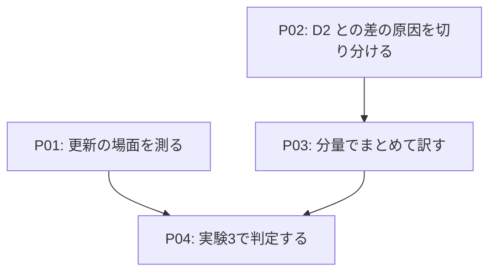

# Roadmap-v05: mdait を使う方が良いと、数字で言える状態にする

## Concept

mdait の価値は「訳が揃うこと」と「原稿が変わっても訳を保守できること」にある。2026-11 の実験（日本語 → 英語、
15 章の取扱説明書）で、前者は確かめられた。TM が育った状態では、mdait＋Haiku だけが同じ定型文を全出現で
同じ訳にした。Opus に章ごと頼んでも、同じ文を 2〜3 通りに訳した。

一方で、同じ実験では次の2点で負けた。

- **費用**: mdait＋Haiku は、Haiku に章ごと頼む方法（以下 D2。章全体と用語集を渡し、thinking なしで訳を返させる）の
  約 5.5 倍かかり、Opus に章ごと頼むのとほぼ同じだった。
- **自然さ**: 匿名の採点で D2 が3章とも1位で、mdait は「直訳調」と評された（自然さ 7.0 点。D2 は 8.0 点）。

しかも測ったのは「最初から訳す」場面だけで、mdait が得意なはずの「原稿を更新する」場面は一度も測っていない。

このロードマップを終えたとき、こう言える状態になっている。

> 同じ Haiku で比べて、mdait は初回の翻訳で D2 と同じ質・同じ程度の費用に並び、訳の一貫性では上回る。
> 原稿の更新では、費用が数分の1で、原文が変わっていない箇所の訳を1行も揺らさない。

この主張は、下の **勝ちの条件** を実験の前に固定し、条件どおりに判定する。満たさなかった項目は、
満たさなかったと書く。

### 勝ちの条件（相手は D2。Opus に章ごと頼む方法も並べる）

| 場面 | 指標 | 条件 |
|---|---|---|
| 初回 | 匿名の採点の順位 | D2 と同じか上 |
| 初回 | 定型文の一貫性（後半の訳が前半と同じ割合） | 95% 以上（今は 100%） |
| 初回 | 費用 | D2 の 1.5 倍以内 |
| 更新 | 1回の更新の費用 | 変わった章を D2 で訳し直す費用の 1/3 以下 |
| 更新 | 原文が変わっていない行で、訳が変わった行の数 | 0 に近い（D2・D3 より明らかに少ない） |
| 更新 | 原文が変わった箇所が訳に反映された割合 | D3 と同じか上 |

D3 は「前の訳と新しい原文を渡して直させる」頼み方で、更新の場面の強い相手として置く（D2 だけと比べると、
わざと弱い相手を選んだことになる）。

スコープ外: 英語以外への翻訳の質の最適化（測りはするが、言語ごとの調整はしない）。モデルの選び直し。

未決事項: 初回で D2 に並べなかった場合の位置づけ（Notes を参照）。

## Map

P01 と P02 は互いに依存しない。P01 は今の実装のまま測る。

## Phases

### P01: 更新の場面を測る

**Why**

mdait は変わったユニットだけを訳し直し、それ以外の訳に手を触れない。この強みは設計の中心にあるのに、
数字が1つも無い。今の実装のままで勝てる見込みが最も高く、最初にはっきりした主張を出せる。

**WHAT**

実験2の原稿と訳（mdait の群）を出発点に、原文を数版にわたって書き換え、版ごとに訳を更新させる。

- 書き換えは、実際の保守で起きる種類を混ぜる。誤字の修正、文の追加・削除、手順の差し替え、節の追加、
  用語の言い換え。版ごとの書き換えは、どの行を変えたかを記録しておく（正解になる）。
- 群は3つ。
  - mdait: sync → trans（改訂はパッチ、新しい節は新規翻訳）。
  - D2: 変わった章を丸ごと訳し直す。
  - D3: 変わった章について、前の版の訳と新しい原文を渡し、直した訳を返させる。
- 測るもの: 1版あたりの費用、原文が変わっていない行で訳が変わった行の数、原文の変更が訳に反映された割合、
  定型文の一貫性、書式の崩れ。

**Steps**

- [ ] 書き換えの台本を作る（4版。各版で 3〜5 章を書き換え、変えた行を記録する）
- [ ] 3群を各3回走らせる
- [ ] 指標を計算する（実験2の突き合わせを流用する）
- [ ] 結果を報告にまとめる

**Gates**

- [ ] 3群とも、全版の訳が書式を保ったまま出そろっている
- [ ] 「原文が変わっていない行の訳の変化」が、書き換えの記録と突き合わせて数えられている

### P02: D2 との差の原因を切り分ける

**Why**

D2 と mdait の頼み方は、少なくとも5点で違う（Notes を参照）。どれが自然さと費用の差を生んでいるのかを
知らずに作り直すと、効かない変更に手間をかけるか、効いていた仕組みを捨てることになる。

**WHAT**

mdait の指示文を外から組み立て、1点ずつ変えて訳させ、D2 と並べて採点する。製品のコードは変えない。

- V0: 今の mdait（1ユニットずつ。前後1ユニットを参考に付ける。JSON で返し、用語候補も書かせる）。
- V1: V0 から用語候補を外し、訳を素の Markdown で返させる。
- V2: V1 で、連続するユニットを一定の分量（D2 と同じ約 2,500 字）までまとめて1回で頼む。
- V3: V2 で、指示文を D2 と同じくらい短くする。
- 比べる相手は D2。同じ3章で、匿名の採点（審査員を2つにする）と費用を測る。

**Steps**

- [ ] V0〜V3 の指示文を組み立てる台本を書く（mdait の指示文と TM の参考の付け方を写す）
- [ ] 3章 × 4版 × 3回を訳させる
- [ ] 匿名の採点と費用を集計し、差を生んでいる要因を特定する

**Gates**

- [ ] V0 の結果が実験2の mdait の結果と大きく食い違わない（台本が mdait を写せている）
- [ ] 要因ごとの効き目が、自然さと費用の両方で数字になっている

### P03: 分量でまとめて訳す

**Why**

P02 で効くと分かった要因を製品に入れる。実験2の時点で、まとめて頼むことは費用（同じ指示文を 126 回送っていた）と
自然さ（1節ずつ切って訳していた）の両方に効く見込みが最も大きい。

**WHAT**

新しく訳すユニットのうち、同じファイルで連続するものを、一定の分量（設定で変えられる。既定は P02 の結果で決める）
まで1回の依頼にまとめる。章やファイルの区切りではなく、**一度に渡す分量**で決める。

- 改訂（パッチ）は今のまま1ユニットずつ頼む。まとめるのは新規翻訳だけにする。
- 答えはユニットごとに分けて返させ、ユニットへ書き戻す。分け方がおかしければ、そのまとまりだけ1ユニットずつの
  頼み方へ戻す。
- 用語集と TM の参考は、まとめた分のユニットに当たったものを合わせて渡す。
- P02 の結果しだいで、答えの形（素の Markdown）、用語候補の扱い、指示文の長さも見直す。
- 録音の再生（`lab regress`）の録り直しが要る。何が変わったかを先に説明できるようにしてから録り直す。

[TODO] 実行時見直し: P02 の結果で、まとめる分量の既定値と、答えの形・用語候補の扱いを決める。

**Steps**

- [ ] ADR を書く（まとめ方・分量の決め方・失敗したときの戻り方）
- [ ] まとめて頼む処理と、答えをユニットへ分ける処理を実装する
- [ ] 単体テスト（分け方がおかしい答え・コードブロックの目印・frontmatter）
- [ ] `lab regress` の録音を録り直し、`lab sweep` と `npm test` を通す
- [ ] 実験2の原稿で、費用と自然さが P02 の見込みどおりに変わるかを確かめる

**Gates**

- [ ] `npm test`・`lab sweep`・`lab regress` が通る
- [ ] 実験2の原稿で、往復の回数と費用が下がっている
- [ ] 定型文の一貫性が下がっていない

### P04: 実験3で判定する

**Why**

P01 と P03 の結果を、事前に固定した勝ちの条件で判定する。実験2の弱点を直した測り方で行い、
「mdait を使う方が良い」かどうかに答える。

**WHAT**

- 初回の翻訳: P03 を入れた mdait、D2、Opus に章ごと頼む方法。用語集はどれも使い分けの規則つきにする。
- 更新: P01 と同じ台本を、P03 を入れた mdait で走らせ直す。
- 実験2の弱点を直す。
  - 審査員を複数にし、2章を並べて見せて章をまたぐ一貫性も採点に入れる。
  - 英語のほかにもう1言語で測る。
  - 正解のラベルを全件見直す。

[TODO] 実行時見直し: 実在の文書（版の履歴のある OSS の文書）を原稿に使えるかを探す。使えれば、原稿を AI が書いた
という弱点も消える。

**Steps**

- [ ] 原稿と正解を用意する
- [ ] 初回と更新を各3回走らせる
- [ ] 勝ちの条件で判定し、報告を書く

**Gates**

- [ ] 勝ちの条件の全項目に、満たしたかどうかの判定が付いている

## Gates

- [ ] 勝ちの条件を、初回と更新の両方で満たしている。満たさない項目があれば、その理由と次の一手が書かれている

## Notes

### D2 と mdait の頼み方の違い（2026-11-09 時点の実装）

| 点 | D2 | mdait |
|---|---|---|
| 一度に渡す量 | 章全体（約 2,500 字）を1回 | 1ユニット（後半10章で平均約 230 字）。前後1ユニットの原文を参考に付ける（`trans.contextSize` 既定 1） |
| 答えの形 | 素の Markdown | 訳を JSON の文字列に詰め、用語候補も同じ答えに書かせる（答えの 51% が用語候補） |
| 指示文 | 6行＋用語集 | 約 4,500 字。「構造を厳守」「行数を自己点検」の強い指示が並ぶ |
| 用語集 | 全部を渡す | 当たった語だけを渡す |
| TM | なし | 似た文の過去の訳を参考に付ける |

thinking はどちらも使っていない。

自然さの差は、一度に渡す量（文の流れが見えない）、答えの形（JSON の中で訳を書く負担、用語候補との二重の仕事）、
指示文の強さ（構造の厳守を繰り返すと、直訳に寄る）のどれか、またはその組み合わせから来ていると見ている。
P02 はこれを切り分けるためにある。

### 外した案

- **TM と完全に一致したユニットを、AI に頼まずに採る**: TM は文の単位で、mdait のユニットは節の単位なので、
  ユニット全体が完全に一致することはまれである。実験2の定型文も、節の中の1文として現れていた。効き目が小さいので外す。

### 初回で D2 に並べなかった場合

mdait を保守の道具として位置づける。初回は Haiku に章ごと訳させて取り込み、そのあとの更新を mdait で回す使い方を勧める。
P01 で更新の勝ちを確かめておけば、この位置づけでも主張は成り立つ。
